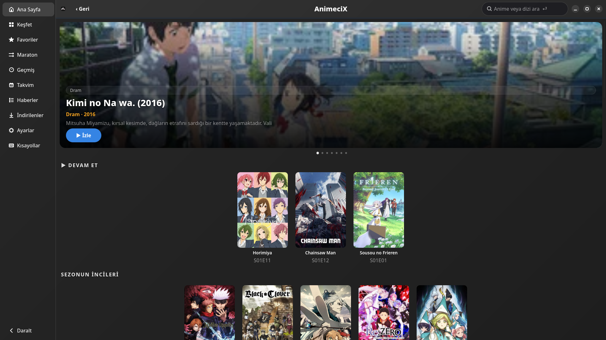
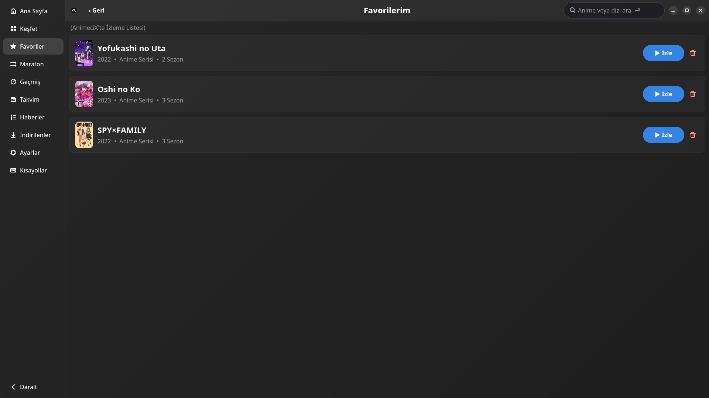
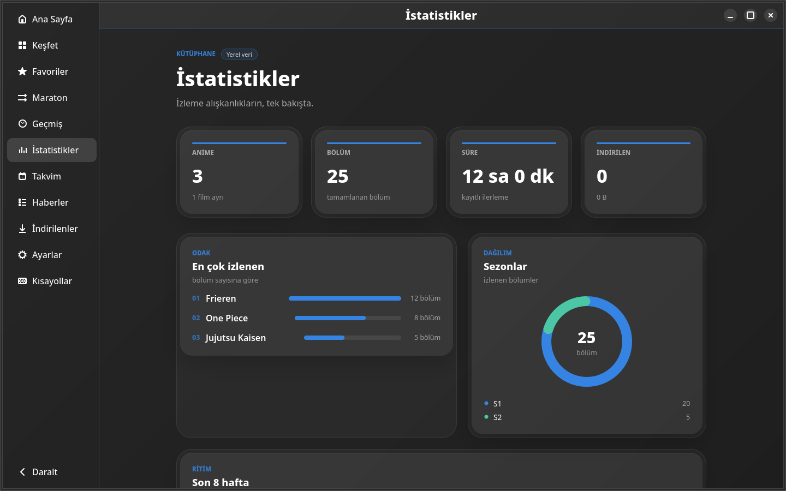
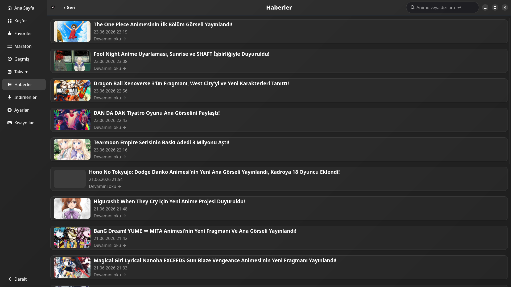
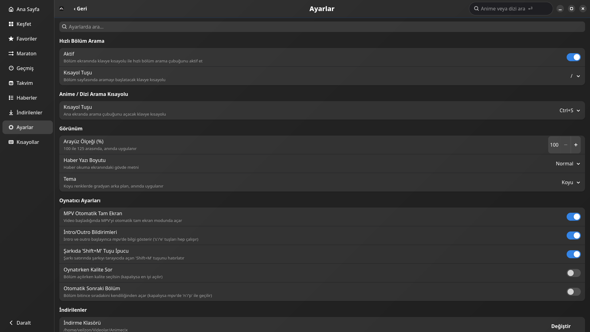
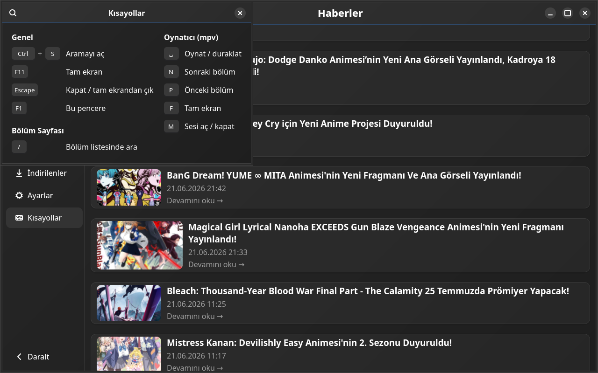

# AnimeciX Linux

[](https://veilzon.github.io/animecix-linux/)
[](https://github.com/veilzon/animecix-linux/releases/latest)
[](LICENSE)


**Linux için GTK4/libadwaita ile yazılmış anime, dizi ve film izleme masaüstü istemcisi.**

**Flatpak** (önerilen), **.deb/.rpm** paketleri veya tek dosyalık taşınabilir
**AppImage** olarak dağıtılır. Flatpak kendi depomuzdan kurulur; güncellemeler uygulama içinden
denetlenir ve `flatpak update` ile de yapılabilir. Flatpak kendi libmpv'sini taşır; AppImage
libmpv'yi paket içinde getirir, deb/rpm sistemdeki libmpv'yi (`mpv` paketi) ve GTK4/libadwaita'yı kullanır.
Harici mpv oynatıcısı Ayarlar'dan isteğe bağlı seçilebilir.
Sürüm notları için [CHANGELOG.md](CHANGELOG.md).

> ⚠️ Bu uygulama **gayriresmî** ve eğitim/kişisel kullanım amaçlıdır; herkese açık bir API
> kullanır. Hizmet sağlayıcıya zarar vermeden, kendi sorumluluğunuzda kullanın.

---

## Özellikler

- **Yan menü**: Ana Sayfa, Keşfet, Favoriler, Maraton, Geçmiş, İstatistikler, Takvim, Haberler, İndirilenler, Ayarlar ve Kısayollar tek tıkla; daraltınca sadece simgeler kalır
- **Ana sayfa**: tam genişlikte öne çıkan (hero) öneri, iskelet yükleme, kaldığın bölümler (Devam rafı, sayfalanmaz) ve sayfalı raflar
- **Keşfet / Takvim / Haberler**: tür-sıralama filtreli katalog, yayın takvimi, uygulama içi haberler (yazı boyu ayarlanabilir)
- **5 koyu tema**: Koyu, Bordo, Orman, Lacivert, Mor; karşılama ekranında canlı önizleme
- **Hızlı arama**: ana sayfadaki öne çıkan alanın üstündeki arama çubuğu Enter ile sonuç penceresi açar; bölüm ekranında hızlı bölüm arama
- **Oynatıcı**: Gömülü libmpv oynatıcı (varsayılan, Lowell benzeri kontroller, şarkı kartları) veya Ayarlar'dan harici mpv; otomatik tam ekran, resmi intro/outro atlama (`s`/`e`), çalan şarkı bilgisi ve Shift+M ile tarayıcıda açma, `n`/`p` ile önceki/sonraki bölüm (otomatik geçiş ayarı da var), kaynak/fansub seçici ve kalite ölçümü; indirilmiş bölümlerde de intro/outro atlama çalışır
- **Oynatma geri bildirimi**: Önbellek doluluk çubuğu, oynatma butonunda yükleme dönengeci ve seek sırasında görsel geri bildirim; otomatik sonraki bölümle birlikte outro'yu atlama
- **Takip**: Favoriler, sürükle-bırak sıralamalı Maraton, izleme Geçmişi, kaldığın yerden devam; izlendi işaretlenen bölümün ilerleme çubuğu anında dolar
- **İstatistikler**: anime/bölüm/süre özeti, en çok izlenenler, sezon dağılımı ve son 8 haftanın izleme ritmi; filmler bölüm sayılmaz, ayrı film sayısı gösterilir
- **Discord Rich Presence**: Discord'da izlediğin anime/film ve bölüm bilgisi görünür; varsayılan açık, Ayarlar → Discord'dan kapatılabilir veya socket yolu değiştirilebilir
- **İndirme yöneticisi**: bölüm ve film indirme, kaldığı yerden devam, toplu indirme; indirilen bölümler listede işaretlenir, sağ tıkla indirilebilir ve normal oynatmada yerel dosyadan öncelikli açılır
- **Bellek toparlama**: Harici mpv oturumu kapandıktan sonra kapak ve geçici önbellek belleği toparlanır
- **Yerel mod**: Hesap/giriş özellikleri bu derlemede kapalı; favoriler, geçmiş ve izleme ilerlemesi cihazda saklanır
- **Akıllı kaynak seçimi**: Tau aynalarında en iyi kalite seçilir; diğer kaynaklarda ilk çalışan kullanılır. Ölü kaynak elenir, açılmayan kaynakta sonrakine geçilir; manuel kaynak seçimi vardır.
- **Flatpak**: kendi Flatpak depomuzdan tek komutla kurulum; güncellemeler uygulama içinden denetlenir
- **Otomatik güncelleme**: AppImage, .deb, .rpm ve Flatpak kurulumları başlatmada yeni sürümü denetler, tek tıkla günceller (yetki istenir); GitHub indirmeleri paralel parçalarla hızlandırılır
- **Kurulum sihirbazı**: bağımlılık kontrolü ve masaüstü başlatıcı kurulumu
- **Arayüz ölçeği**: %100–%125 arası serbest değer, anında uygulanır
- **Ayarlar**: tema, kısayollar, haber yazı boyu, indirme klasörü, Discord RPC, masaüstü başlatıcı, veri sıfırlama
- **Hızlı yükleme**: HTTP/2 multiplexing ve bağlantı havuzu (keep-alive);
  kapak görselleri paralel (3 worker) indirilir

---

## Ekran Görüntüleri

_ekran görüntüleri her zaman güncel olmayabilir._

<p align="center">

<div align="center">

| | |
|:---:|:---:|
|  |  |
| **Ana Sayfa** | **Bölümler** |
|  |  |
| **Keşfet** | **Film** |
|  |  |
| **Favoriler** | **İzleme Maratonu** |
|  |  |
| **Geçmiş** | **İstatistikler** |
|  |  |
| **Yayın Takvimi** | **Haberler** |
|  |  |
| **İndirilenler** | **Ayarlar** |
|  | |
| **Kısayollar (F1)** | |

</div>

---

## Kurulum

### Flatpak (önerilen)

Flatpak kuruluysa tek komutla kur:

```bash
flatpak install --from https://veilzon.github.io/animecix-flatpak/animecix.flatpakref
```

Flatpak uygulamayı kendi depomuzdan kurar; yalnızca GNOME runtime'ı Flathub'dan
gelir. Uygulama açılışta güncellemeyi denetler; manuel güncelleme:

```bash
flatpak update io.github.veilzon.AnimeciX
```

Kaldırma:

```bash
flatpak uninstall io.github.veilzon.AnimeciX
```

### AppImage

1. [Releases](https://github.com/veilzon/animecix-linux/releases) sayfasından `AnimeciX-x86_64.AppImage` dosyasını indirin.
2. Çalıştırılabilir yapın ve açın:

   ```bash
   chmod +x AnimeciX-x86_64.AppImage
   ./AnimeciX-x86_64.AppImage
   ```

AppImage tek dosyadır; sistemde GTK4 ve libadwaita varsa ek kurulum gerektirmez.
libmpv ve bağımlılıkları paketin içinde gelir. Minimal aria2 de paket içindedir; ayrıca
`aria2` kurmana gerek yoktur. Harici mpv kullanmak istersen sistemde `mpv` bulunmalıdır.
İstersen masaüstü başlatıcısını **Ayarlar → Masaüstü Başlatıcısını Sistemime Kur** ile ekleyebilirsin.

### Debian / Ubuntu (.deb)

[Releases](https://github.com/veilzon/animecix-linux/releases/latest) sayfasından
`animecix_1.4.0_amd64.deb` dosyasını indir veya doğrudan:

[**animecix_1.4.0_amd64.deb**](https://github.com/veilzon/animecix-linux/releases/download/v1.4.0/animecix_1.4.0_amd64.deb)

```bash
sudo apt install ./animecix_1.4.0_amd64.deb
```

Debian 12+ ve Ubuntu 24.04+ içindir. `mpv`, `libmpv2`, `libgtk-4-1`, `libadwaita-1-0` ve `aria2`
bağımlılıkları apt tarafından kurulur. Güncellemeler uygulama içinden yapılır;
doğrudan `.deb` dosyasıyla kurulumda `sudo apt upgrade` bu dosyayı güncellemez.

### Fedora / RPM

#### COPR (önerilen)

```bash
sudo dnf copr enable veilzon/animecix
sudo dnf install animecix
```

Güncelleme:

```bash
sudo dnf upgrade animecix
```

> `mpv` RPM Fusion deposunda bulunur. Kurulu değilse önce RPM Fusion'ı ekleyin:
> ```bash
> sudo dnf install https://mirrors.rpmfusion.org/free/fedora/rpmfusion-free-release-$(rpm -E %fedora).noarch.rpm
> ```

#### Doğrudan RPM

[Releases](https://github.com/veilzon/animecix-linux/releases/latest) sayfasından
`animecix-1.4.0-1.fc40.x86_64.rpm` dosyasını indir veya doğrudan:

[**animecix-1.4.0-1.fc40.x86_64.rpm**](https://github.com/veilzon/animecix-linux/releases/download/v1.4.0/animecix-1.4.0-1.fc40.x86_64.rpm)

```bash
sudo dnf install ./animecix-1.4.0-1.fc40.x86_64.rpm
```

Fedora 40+ içindir. `mpv`, `mpv-libs`, `libglvnd-gles`, `gtk4`, `libadwaita` ve `aria2`
bağımlılıkları dnf tarafından kurulur. Güncellemeler uygulama içinden yapılır; doğrudan `.rpm` dosyasıyla kurulumda
`sudo dnf upgrade` bu dosyayı güncellemez. COPR kurulumunda `sudo dnf upgrade animecix`
kullanılabilir.

### Arch Linux

Kendi imzalı pacman depomuz (AUR gerekmez). Tek komut:

```bash
curl -fsSL https://veilzon.github.io/animecix-arch/install.sh -o /tmp/animecix-install.sh
sudo bash /tmp/animecix-install.sh
```

Manuel kurulum:

```bash
curl -fsSL https://veilzon.github.io/animecix-arch/animecix.gpg -o /tmp/animecix.gpg
sudo pacman-key --add /tmp/animecix.gpg
sudo pacman-key --lsign-key 2B2361F1C5D588EF

# /etc/pacman.conf
[animecix]
SigLevel = Required DatabaseOptional
Server = https://veilzon.github.io/animecix-arch/$arch

sudo pacman -Syu
sudo pacman -S animecix
```

Güncelleme: Uygulama içi denetim pacman deposunu kullanır; terminalden
`sudo pacman -Syu` de kullanılabilir.

Arch paketi `mpv` bağımlılığını kullanır; bu paket gömülü oynatıcı için libmpv'yi de
sağlar. Arch paket derlemeleri ayrı CI deposunda test edilir.

### Sistem gereksinimleri

- **Ortak:** x86_64 Linux (Wayland veya X11) ve internet bağlantısı.
- **Flatpak:** Flatpak kurulu olmalı; GNOME runtime'ı Flathub'dan otomatik gelir.
- **AppImage:** glibc ≥ 2.36, GTK ≥ 4.8 ve libadwaita ≥ 1.2. Gömülü oynatıcı için
  libmpv paket içinde gelir; harici mpv isteğe bağlıdır.
  `libfuse.so.2` yoksa `./AnimeciX-x86_64.AppImage --appimage-extract-and-run` kullan.
- **.deb:** Debian 12+ / Ubuntu 24.04+; bağımlılıklar apt tarafından kurulur.
- **.rpm:** Fedora 40+; bağımlılıklar dnf tarafından kurulur.

AppImage için dağıtım paketleri:

```bash
# Debian/Ubuntu (libfuse2 adı sürüme göre libfuse2t64 olabilir)
sudo apt install libgtk-4-1 libadwaita-1-0 libfuse2

# Fedora
sudo dnf install gtk4 libadwaita fuse-libs

# Arch
sudo pacman -S gtk4 libadwaita fuse2
```

> Tüm sürümler ve eski paketler: [Releases](https://github.com/veilzon/animecix-linux/releases).

### Oynatıcı

Varsayılan olarak video **uygulama içinde** libmpv + GtkGLArea ile açılır; ayrı bir mpv
penceresi oluşmaz. **Ayarlar → Gömülü Oynatıcı** kapatılırsa eskisi gibi harici `mpv`
penceresi kullanılır. Gömülü oynatıcı libmpv bulamazsa (ör. eksik sistem paketi) harici
oynatıcıya düşer. AppImage ve Flatpak libmpv'yi kendi içinde taşır; deb/rpm `mpv`
paketinin sağladığı libmpv'yi kullanır.

### Kaynaktan derleme

Gerekli sistem bağımlılıkları:

- **Debian/Ubuntu:** `sudo apt install libgtk-4-dev libadwaita-1-dev mpv libmpv-dev pkg-config build-essential cmake libclang-dev`
- **Fedora:** `sudo dnf install gtk4-devel libadwaita-devel mpv mpv-libs-devel pkgconf-pkg-config gcc-c++ make cmake clang-devel`
- **Arch:** `sudo pacman -S gtk4 libadwaita mpv pkgconf base-devel cmake clang`

Testleri çalıştırmak için ayrıca `ffmpeg`, `xvfb` ve `xauth` gerekir.

Güncel stable Rust kurulu olmalı:

```bash
git clone https://github.com/veilzon/animecix-linux.git
cd animecix-linux
cargo build --release
./target/release/animecix
```

Release derlemesi CI ile aynı şekilde `cargo build --release --locked` ile yapılır.

---

## Güncelleme

Uygulama AppImage, .deb, .rpm ve Flatpak kurulumlarında başlangıçta yeni sürümü denetler:

- **Otomatik:** *Ayarlar → Güncelleme → Otomatik Güncelleme* açıkken yeni sürüm bulunursa
  onay kutusu çıkar; “Güncelle ve Yeniden Başlat” deyince indirir, kurar ve uygulamayı yeniden başlatır.
- **Elle:** *Ayarlar → Şimdi Güncelle* ile istediğin an kontrol edebilirsin.
- **Paketler:** .deb/.rpm güncellemeleri GitHub'dan indirilip sistem paket
  yöneticisiyle (`apt-get`/`dnf`/`zypper`) kurulur; kurulum sonrası sürüm
  doğrulanır. Doğrudan dosyadan kurulumda `apt upgrade`/`dnf upgrade` bu dosyayı
  güncellemez; COPR gibi depo kurulumlarında paket yöneticisi kullanılabilir.
- **Flatpak:** Güncelleme `flatpak update` ile yürütülür; uygulama yeni sürümü
  başlangıçta bildirir.
- **Paralel indirme:** Güncelleme dosyaları birden çok bağlantıyla indirilir;
  sunucu desteklemezse tek bağlantıya düşülür.
Kaynaktan derlenen sürümde otomatik güncelleme devre dışıdır.

---

## Geliştiriciler için derleme & yayın

Sürüm hazırlığı:

1. `Cargo.toml`, `CHANGELOG.md` ve uygulama içi `changelog_items` metnini güncelle;
   ardından `python3 packaging/update-metainfo.py --write` ile Flatpak/AppStream
   metainfo sürümünü eşitle.
2. Testleri çalıştır:

   ```bash
   xvfb-run -a cargo test --release --bin animecix -- --test-threads=1
   cargo test --release --test refcell_guard --test next_episode
   python3 tests/skip_harness.py
   python3 tests/flatpak_updater.py
   ```

3. Tag’i oluştur ve gönder:

   ```bash
   git tag -a vX.Y.Z -m "AnimeciX vX.Y.Z"
   git push origin main vX.Y.Z
   ```

4. AppImage release artefaktı CI'da üretilir; yerel deneme için
   `build_appimage.sh` kullanılabilir:
   - `.github/workflows/appimage.yml` her `main` push’unda Debian 12 tabanlı
     (glibc 2.36) ve minimal aria2’li AppImage’i üretip artifact olarak yükler.
   - `.github/workflows/release.yml` tag push’unda AppImage’i üretir ve taslak
     release’e ekler.

5. Taslak release’i kontrol edip yayınla:

   ```bash
   gh release edit vX.Y.Z --draft=false --latest
   ```

   `.github/workflows/package.yml` yayınlanan release’e deb/rpm paketlerini ekler.

### Ortam değişkenleri

Geliştirme, test ve hata ayıklama için kullanılabilecek değişkenler:

| Değişken | Etki |
|---|---|
| `ANIMECIX_CHANGELOG_PREVIEW=1` | Sürüm notlarını, daha önce görülmüş olsa bile açılışta zorla gösterir. |
| `ANIMECIX_PLAYER_NO_SHADE=1` | Gömülü oynatıcıdaki üst/alt karartma katmanını kapatır. |
| `ANIMECIX_BENCH=1` | API ve kapak isteklerinin sürelerini `[bench]` satırlarıyla stderr’e yazar. |
| `ANIMECIX_LIBMPV_PATH=/yol/libmpv.so.2` | Belirli bir libmpv dosyasını kullanmaya zorlar. |
| `ANIMECIX_STATE_DIR=/tmp/animecix-test` | `state.json` için farklı bir dizin kullanır (temiz profil testi). |
| `ANIMECIX_SMOKE_HOLD=5` | `--player-smoke` testinde videoyu 5 sn tutar; normal oynatıcıda kontrollerin otomatik gizlenmesini engeller. |
| `ANIMECIX_SMOKE_THEME=bordo` | `--player-smoke` teması: `koyu`, `bordo`, `orman`, `lacivert`, `mor`. |
| `ANIMECIX_FAKE_INSTALL_KIND=deb` | Yalnız debug derlemede güncelleme akışındaki kurulum türünü taklit eder (`deb`, `rpm`, `arch` veya `appimage`). |
| `ANIMECIX_FAKE_PKG_VERSION=1.2.3` | Yalnız debug derlemede kurulu paket sürümünü taklit eder. |
| `ANIMECIX_VAULT_URL=...` | İntro/outro kasa adresini geçici olarak değiştirir. |
| `ANIMECIX_VAULT_KEY` | Derleme anında gömülen 64 hex’lik kasa anahtarı; çalışma anında okunmaz. |
| `ANIMECIX_MINIMAL_ARIA2=1` | AppImage’ı yalnız HTTP/HTTPS destekli minimal aria2 ile üretir. |
| `MINIMAL_LIBMPV_DIR=/yol` | Paketlenecek minimal libmpv dizinini seçer. |

Örnekler:

```bash
ANIMECIX_CHANGELOG_PREVIEW=1 ./AnimeciX-x86_64.AppImage
ANIMECIX_LIBMPV_PATH=/tmp/libmpv.so.2 ./target/release/animecix
ANIMECIX_STATE_DIR=/tmp/animecix-test ./target/release/animecix
```

`build_appimage.sh` ayrıca `VERSION_BUMP=none|patch|minor|major`, `GITHUB_TOKEN` ve
`GITHUB_REPO` değişkenlerini kullanır. GTK/Mesa tarafında `GDK_BACKEND`,
`GSK_RENDERER`, `LIBGL_ALWAYS_SOFTWARE` ve `GTK_A11Y` standart olarak kullanılabilir.

### Tanı komutları

| Bayrak | Etki |
|---|---|
| `--check-libmpv` | libmpv bulunabilirliğini ve API sürümünü doğrular. |
| `--check-shaders` | Paketlenen Anime4K shader dosyalarını denetler. |
| `--check-icons` | Gömülü/sistem ikonlarının varlığını denetler. |
| `--player-smoke <video>` | Gömülü oynatıcıyı yerel bir videoyla açar; CI smoke testi. |
| `--goto <sayfa>` | Açılışta belirtilen sayfaya gider (ör. `--goto home`). |

---

## Klavye Kısayolları

| Kısayol | İşlev |
|---|---|
| `F1` | Kısayollar penceresini aç |
| `F11` | Tam ekran |
| `/` | Bölüm ekranında hızlı bölüm arama |
| `Ctrl+S` | Arama penceresini açar |
| `Space` | Oynatıcıda oynat / duraklat |
| `←` / `→` | Oynatıcıda 10 sn geri / ileri |
| `↑` / `↓` | Oynatıcıda sesi artır / azalt |
| `F` | Oynatıcıda tam ekran |
| `A` | Oynatıcıda ekranı doldur / orijinal oran |
| `s` / `e` | Oynatıcıda introyu / outroyu atla |
| `n` / `p` | Oynatıcıda sonraki / önceki bölüm |
| `m` | Oynatıcıda sesi aç / kapat |
| `Shift+M` | Gömülü oynatıcıda çalan şarkıyı tarayıcıda aç (harici mpv'de `M`) |
| `Ctrl+RIGHT` | Yalnızca harici mpv'de sonraki bölüm |
| `Esc` | Tam ekrandan / maximize'dan çık |

Bölüm hızlı araması ve ana arama kısayolu *Ayarlar* ekranından değiştirilebilir;
oynatıcı tuşları sabittir.

---

## Yapılandırma & Veri

Başlıca veriler şurada tutulur:

```
~/state.json                              # izleme geçmişi, favoriler, maraton, ilerleme
~/.local/share/animecix/settings.json     # ayarlar
~/.local/share/animecix/downloads.json    # indirme kuyruğu
~/.local/share/animecix/restart.log       # güncelleme sonrası yeniden başlatma günlüğü
~/.cache/animecix/                        # API ve kapak önbelleği
~/.cache/animecix/updates/                # indirilen güncelleme paketleri
```

*Ayarlardan* “Tüm Verileri Sıfırla ve Temizle” ile sıfırlanabilir.

---

## Performans

Uygulama, ağ gecikmesini azaltmak için aşağıdaki teknikleri kullanır:

- **HTTP/2 multiplexing**: Tek TCP/TLS bağlantısı üzerinden çoklu eşzamanlı akış; özellikle
  ana sayfadaki onlarca kapak görselini sıraya sokmadan paralel getirir.
- **Bağlantı havuzu & keep-alive**: Boşta bağlantılar 20 sn boyunca sıcak tutulur
  (`pool_idle_timeout`), böylece her istekte tekrar TLS el sıkışması yapılmaz.
- **Paralel kapak indirme**: 3 worker ile kapaklar eşzamanlı çekilir (diskte 7 gün önbellekli).
- **API önbelleği**: Süresi dolmuş kayıt yenilenirken ağ hatası olursa son önbellek
  kullanılır; çevrimdışıyken eski veri gösterilebilir.

> Geliştiriciler: `ANIMECIX_BENCH=1 ./target/release/animecix` ile her isteğin süresini
> stderr'a loglayabilir (davranışı etkilemez).

---

## Resmi İntro/Outro Verisi

AnimeciX, intro ve outro süreleri ile açılış/kapanış şarkı bilgilerini
AnimeciX'in resmi video altyapısından alır; sonuç 6 saat önbelleğe alınır.
Gömülü oynatıcıda plan video başladıktan sonra arka planda çözülür; harici mpv
yolunda video açılmadan önce çözülür.

**Davranış**:
- `s` / `e` tuşları intro/outro sonuna atlar; indirilmiş bölümlerde de çalışır.
  Gömülü oynatıcıda uygulama bildirimi, harici mpv'de OSD gösterilir.
- Gömülü oynatıcıda şarkı kartı intro/outro penceresinde sol altta görünür ve
  10 sn sonra gizlenir; `Shift+M` şarkıyı tarayıcıda açar. Harici mpv'de şarkı
  bilgisi yine intro/outro aralığında gösterilir.
- Gömülü oynatıcıda atla düğmesi ve şarkı kartı, harici mpv'de intro/outro
  bildirimleri ve `Shift+M` ipucu Ayarlar'dan kapatılabilir; tuşlar çalışmaya
  devam eder.

---

## Lisans

[MIT](LICENSE) © 2026 veilzon
