# AnimeciX Linux

[](https://veilzon.github.io/animecix-linux/)
[](https://github.com/veilzon/animecix-linux/releases/latest)
[](LICENSE)


**Linux için GTK4/libadwaita ile yazılmış anime, dizi ve film izleme masaüstü istemcisi.**

Tek dosyalık taşınabilir **AppImage** olarak dağıtılır; sistemde GTK4, libadwaita ve mpv
kuruluysa ek kurulum gerektirmez. Uygulama başlatmada yeni sürümü kontrol eder ve kendini
otomatik güncelleyebilir. Sürüm notları için [CHANGELOG.md](CHANGELOG.md).

> ⚠️ Bu uygulama **gayriresmî** ve eğitim/kişisel kullanım amaçlıdır; herkese açık bir API
> kullanır. Hizmet sağlayıcıya zarar vermeden, kendi sorumluluğunuzda kullanın.

---

## Özellikler

- **Yan menü**: Ana Sayfa, Keşfet, Favoriler, Maraton, Geçmiş, İstatistikler, Takvim, Haberler, İndirilenler, Ayarlar ve Kısayollar tek tıkla; daraltınca sadece simgeler kalır
- **Ana sayfa**: tam genişlikte öne çıkan (hero) öneri, iskelet yükleme, kaldığın bölümler (Devam rafı), sayfalı raflar
- **Keşfet / Takvim / Haberler**: tür-sıralama filtreli katalog, yayın takvimi, uygulama içi haberler (yazı boyu ayarlanabilir)
- **5 koyu tema**: Koyu, Bordo, Orman, Lacivert, Mor; karşılama ekranında canlı önizleme
- **Hızlı arama**: ana sayfadaki öne çıkan alanın üstündeki arama çubuğu Enter ile sonuç penceresi açar; bölüm ekranında hızlı bölüm arama
- **Oynatıcı**: MPV ile oynatma, otomatik tam ekran, resmi intro/outro atlama (`s`/`e`), çalan şarkı bilgisi ve Shift+M ile tarayıcıda açma, `n`/`p` ile önceki/sonraki bölüm (otomatik geçiş ayarı da var), isteğe bağlı oynatma kalite seçici; indirilmiş bölümlerde de intro/outro atlama çalışır
- **Takip**: Favoriler, sürükle-bırak sıralamalı Maraton, izleme Geçmişi, kaldığın yerden devam; izlendi işaretlenen bölümün ilerleme çubuğu anında dolar
- **İstatistikler**: anime/bölüm/süre özeti, en çok izlenenler, sezon dağılımı ve son 8 haftanın izleme ritmi; filmler bölüm sayılmaz, ayrı film sayısı gösterilir
- **İndirme yöneticisi**: bölüm ve film indirme, kaldığı yerden devam, toplu indirme; indirilen bölümler listede işaretlenir, sağ tıkla indirilebilir ve normal oynatmada yerel dosyadan öncelikli açılır
- **Bellek toparlama**: MPV kapandıktan sonra kapak ve geçici önbellek belleği toparlanır
- **Hesap**: giriş/çıkış, profil; favori, konum ve geçmiş siteyle çift-yön eşitlenir
- **Akıllı kaynak seçimi**: kaynaklar paralel çözülür, en kalitelisi seçilir; ölü kaynak elenir, açılmayan kaynakta sonrakine geçilir. manuel kaynak seçimi mevcuttur.
- **Otomatik güncelleme**: AppImage, .deb ve .rpm kurulumları başlatmada yeni sürümü denetler, tek tıkla günceller (paketlerde yetki istenir)
- **Kurulum sihirbazı**: bağımlılık kontrolü ve masaüstü başlatıcı kurulumu
- **Arayüz ölçeği**: %100–%125 arası serbest değer, anında uygulanır
- **Ayarlar**: tema, kısayollar, haber yazı boyu, indirme klasörü, masaüstü başlatıcı, veri sıfırlama
- **Hızlı yükleme**: HTTP/2 multiplexing ve bağlantı havuzu (keep-alive);
  kapak görselleri paralel (12 worker) indirilir

---

## Ekran Görüntüleri

_ekran görüntüleri her zaman güncel olmayabilir._

<p align="center">

<div align="center">

| | |
|:---:|:---:|
| 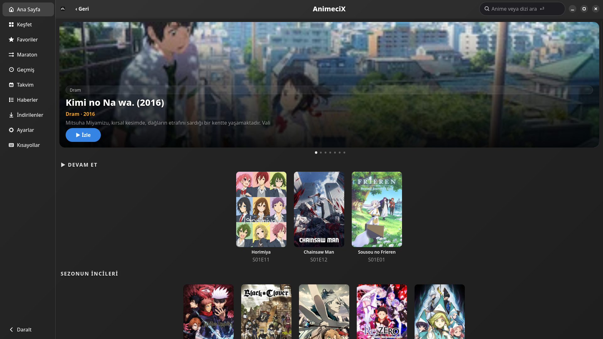 | 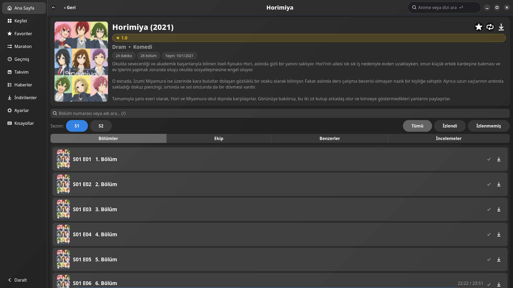 |
| **Ana Sayfa** | **Bölümler** |
| 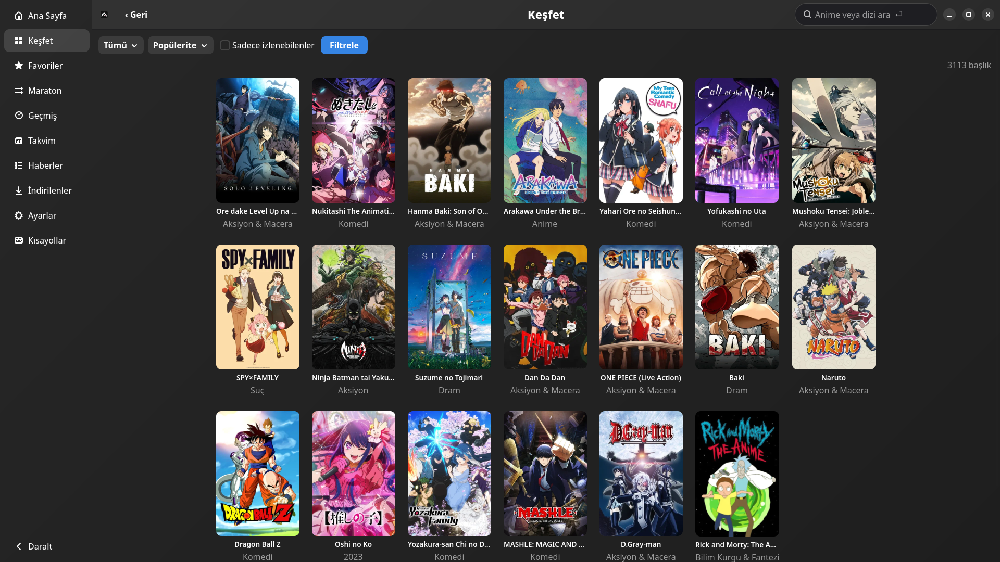 | 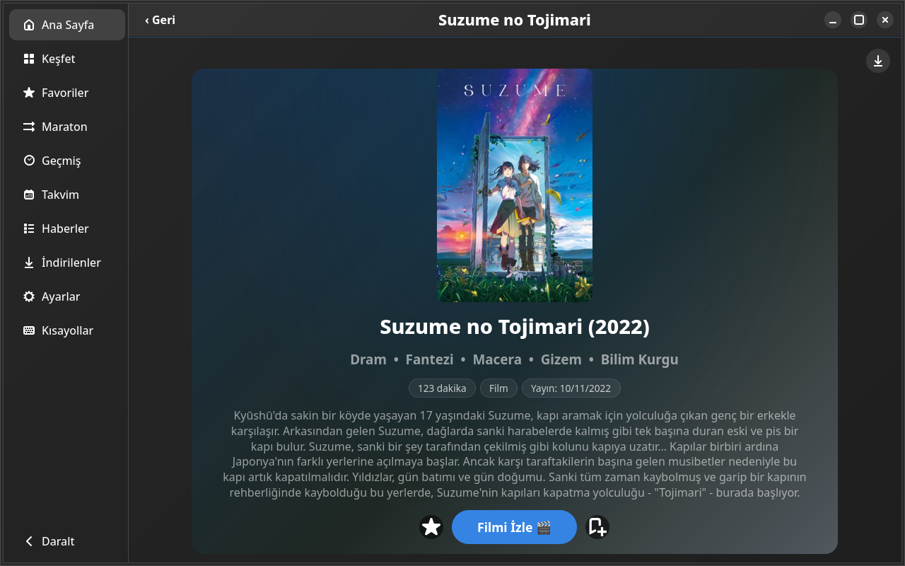 |
| **Keşfet** | **Film** |
| 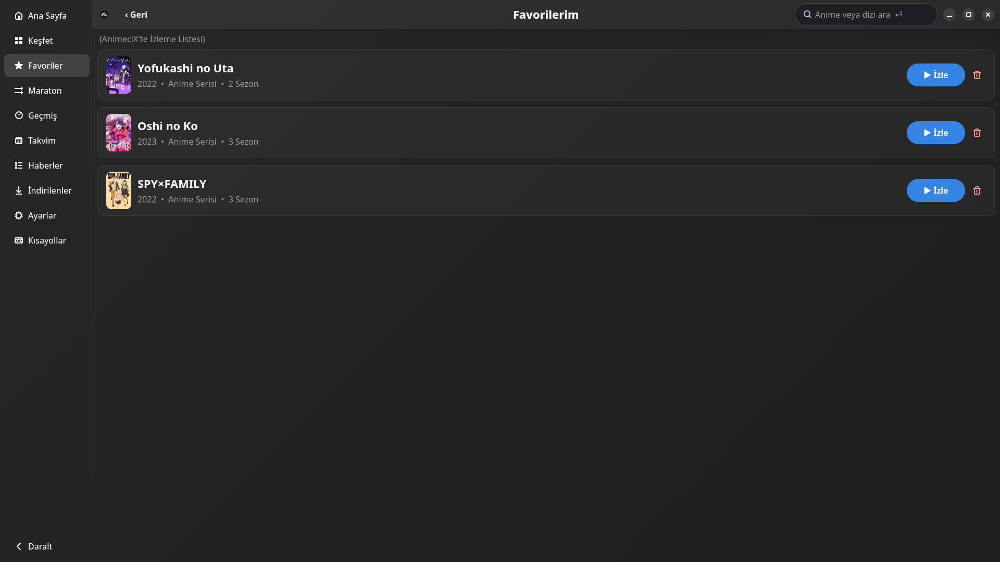 | 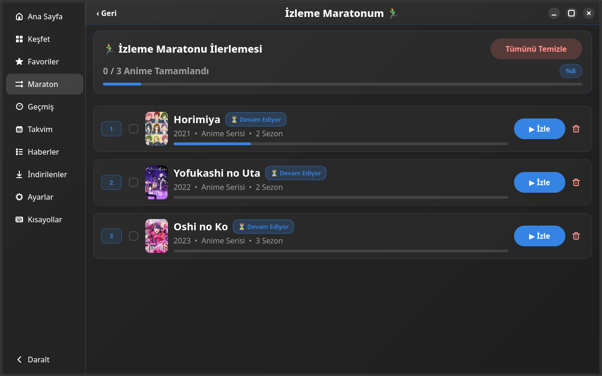 |
| **Favoriler** | **İzleme Maratonu** |
| 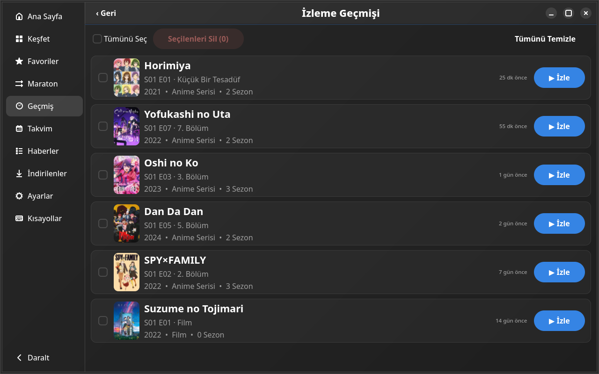 | 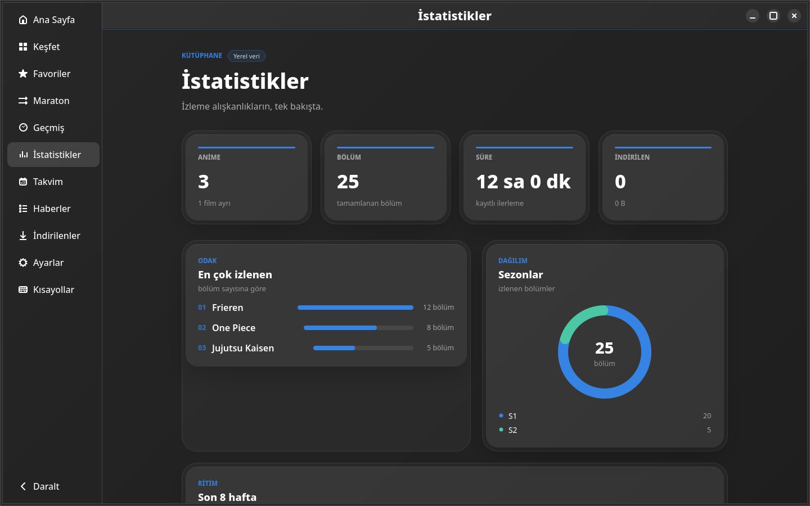 |
| **Geçmiş** | **İstatistikler** |
| 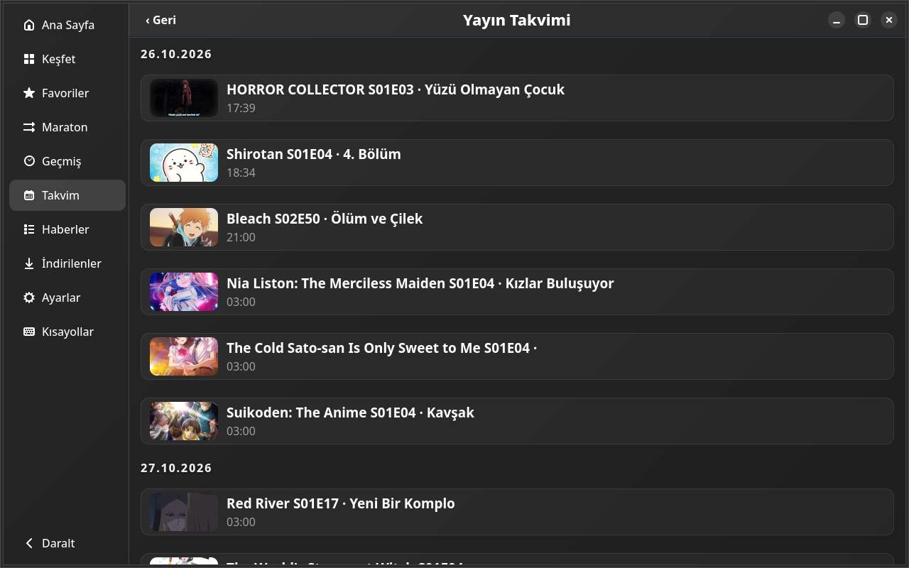 | 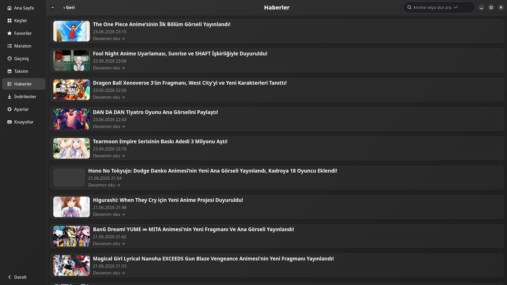 |
| **Yayın Takvimi** | **Haberler** |
| 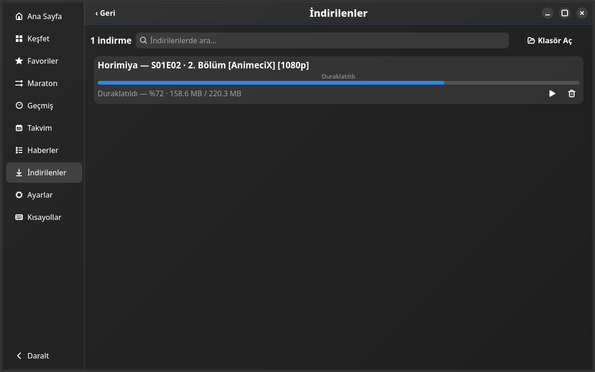 | 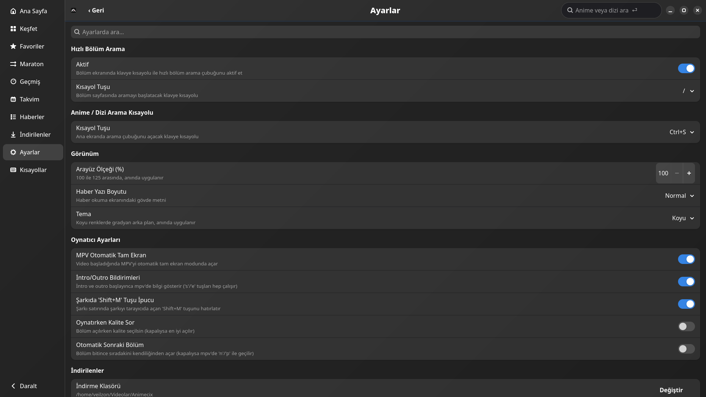 |
| **İndirilenler** | **Ayarlar** |
| 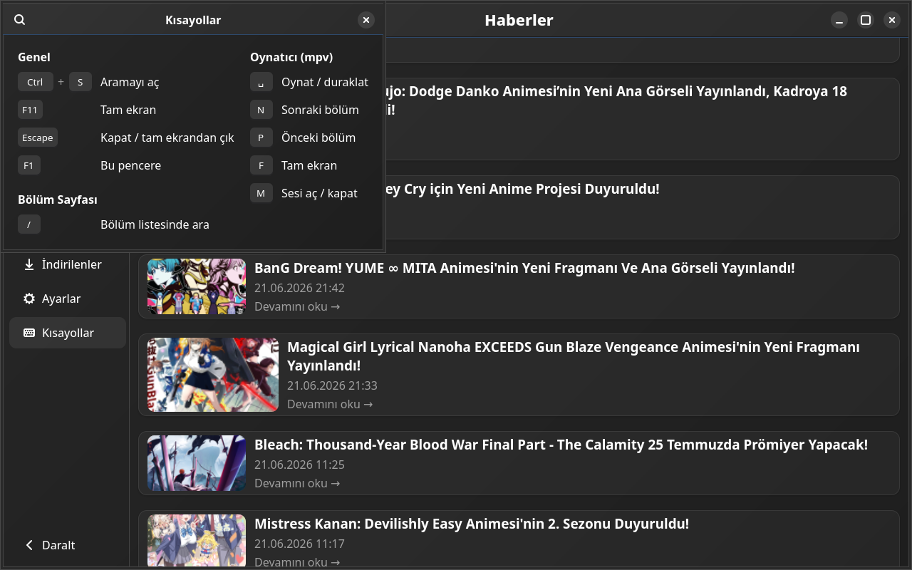 | |
| **Kısayollar (F1)** | |

</div>

---

## Kurulum

### AppImage (önerilen)

1. [Releases](https://github.com/veilzon/animecix-linux/releases) sayfasından `AnimeciX-x86_64.AppImage` dosyasını indirin.
2. Çalıştırılabilir yapın ve açın:

   ```bash
   chmod +x AnimeciX-x86_64.AppImage
   ./AnimeciX-x86_64.AppImage
   ```

AppImage tek dosyadır; sistemde GTK4, libadwaita ve mpv varsa ek kurulum gerektirmez.
İstersen masaüstü başlatıcısını **Ayarlar → Masaüstü Başlatıcısını Sistemime Kur** ile ekleyebilirsin.

#### Sistem gereksinimleri

- x86_64 Linux (Wayland veya X11)
- GTK ≥ 4.8 ve libadwaita ≥ 1.2
- `mpv` (`PATH`'te)
- `libfuse.so.2`; yoksa `./AnimeciX-x86_64.AppImage --appimage-extract-and-run`
- Mevcut release için glibc ≥ 2.39

Dağıtım bazında runtime paketleri:

```bash
# Debian/Ubuntu (libfuse2 adı sürüme göre libfuse2t64 olabilir)
sudo apt install libgtk-4-1 libadwaita-1-0 mpv libfuse2

# Fedora
sudo dnf install gtk4 libadwaita mpv fuse-libs

# Arch
sudo pacman -S gtk4 libadwaita mpv fuse2
```

### Kaynaktan derleme

Gerekli sistem bağımlılıkları:

- **Debian/Ubuntu:** `sudo apt install libgtk-4-dev libadwaita-1-dev mpv pkg-config build-essential cmake libclang-dev`
- **Fedora:** `sudo dnf install gtk4-devel libadwaita-devel mpv pkgconf-pkg-config gcc-c++ make cmake clang-devel`
- **Arch:** `sudo pacman -S gtk4 libadwaita mpv pkgconf base-devel cmake clang`

Güncel stable Rust kurulu olmalı:

```bash
git clone https://github.com/veilzon/animecix-linux.git
cd animecix-linux
cargo build --release
./target/release/animecix
```

---

## Güncelleme

Uygulama bir **AppImage** olarak çalışıyorsa başlangıçta yeni sürümü kontrol eder:

- **Otomatik:** *Ayarlar → Güncelleme → Otomatik Güncelleme* açıkken yeni sürüm bulunursa
  onay kutusu çıkar; “Güncelle ve Yeniden Başlat” deyince indirir, kurar ve uygulamayı yeniden başlatır.
- **Elle:** *Ayarlar → Şimdi Güncelle* ile istediğin an kontrol edebilirsin.
Kaynaktan derlenen sürümde otomatik güncelleme devre dışıdır.

---

## Geliştiriciler için derleme & yayın

Sürüm hazırlığı:

1. `Cargo.toml`, `CHANGELOG.md` ve uygulama içi `changelog_items` metnini güncelle.
2. Testleri çalıştır:

   ```bash
   xvfb-run -a cargo test --release --bin animecix
   python3 tests/skip_harness.py
   ```

3. Temiz AppImage üret (sürümü elle artırdıysan):

   ```bash
   GITHUB_TOKEN= VERSION_BUMP=none bash build_appimage.sh
   ```

4. Tag’i oluştur ve gönder:

   ```bash
   git tag -a vX.Y.Z -m "AnimeciX vX.Y.Z"
   git push origin main vX.Y.Z
   ```

5. Release’i yayınla:

   ```bash
   gh release create vX.Y.Z AnimeciX-x86_64.AppImage \
     --title "AnimeciX vX.Y.Z" \
     --notes-file /tmp/animecix-X.Y.Z-release-notes.md
   ```

`build_appimage.sh` varsayılan olarak `Cargo.toml` sürümünü otomatik artırır;
`VERSION_BUMP=none` bunu atlar. `GITHUB_TOKEN` tanımlıysa betik ayrıca
`v<sürüm>` etiketli bir GitHub Release oluşturup AppImage’ı yükler; ancak
release notlarını `CHANGELOG.md`’den almadığı için önerilen akış yukarıdaki
manuel adımlardır.

Tag push edildiğinde `.github/workflows/release.yml` testleri ve Debian 12
tabanlı AppImage build’ini doğrular; release sayfasına dosya yüklemez. Yerel
build’in glibc gereksinimi host’a bağlıdır; daha eski dağıtımlar için CI’ın
Debian 12 artifact’i (glibc 2.34) kullanılabilir.

---

## Klavye Kısayolları

| Kısayol | İşlev |
|---|---|
| `F1` | Kısayollar penceresini aç |
| `F11` | Tam ekran |
| `/` | Bölüm ekranında hızlı bölüm arama |
| `Ctrl+S` | Ana ekranda arama çubuğuna odaklan |
| `s` | Oynatıcıda intro sonuna atla |
| `e` | Oynatıcıda outro sonuna atla |
| `n` / `p` | Oynatıcıda sonraki / önceki bölüm |
| `Ctrl+RIGHT` | Oynatıcıda sonraki bölüm |
| `Shift+M` (`M`) | Çalan şarkıyı tarayıcıda aç (şarkı bilgisi varsa) |
| `Esc` | Geri / aramayı kapat |

Kısayollar *Ayarlar* ekranından değiştirilebilir.

---

## Yapılandırma & Veri

Tüm veriler şurada tutulur:

```
~/state.json                 # izleme geçmişi, favoriler, maraton, ilerleme
~/.local/share/animecix/     # settings.json
~/.cache/animecix/           # API ve kapak önbelleği
```

*Ayarlardan* “Tüm Verileri Sıfırla ve Temizle” ile sıfırlanabilir.

---

## Performans

Uygulama, ağ gecikmesini azaltmak için aşağıdaki teknikleri kullanır:

- **HTTP/2 multiplexing**: Tek TCP/TLS bağlantısı üzerinden çoklu eşzamanlı akış; özellikle
  ana sayfadaki onlarca kapak görselini sıraya sokmadan paralel getirir.
- **Bağlantı havuzu & keep-alive**: Boşta bağlantılar 60sn boyunca sıcak tutulur
  (`pool_idle_timeout`), böylece her istekte tekrar TLS el sıkışması yapılmaz.
- **Brotli sıkıştırma**: JSON yanıtları `br` ile sıkıştırılarak aktarılır.
- **Paralel kapak indirme**: 12 worker ile kapaklar eşzamanlı çekilir (diskte 7 gün önbellekli).
- **Stale-while-revalidate API önbelleği**: Süresi dolmuş veri anında gösterilir, arka planda
  tazelenir; çevrimdışıyken bile eski veri kullanılır.

> Geliştiriciler: `ANIMECIX_BENCH=1 ./target/release/animecix` ile her isteğin süresini
> stderr'a loglayabilir (davranışı etkilemez).

---

## Resmi İntro/Outro Verisi

AnimeciX, intro ve outro süreleri ile açılış/kapanış şarkı bilgilerini
AnimeciX'in resmi video altyapısından alır.
Video açılmadan önce çözülür; sonuç 6 saat önbelleğe alınır.

**Davranış**:
- `s` / `e` tuşları intro/outro sonuna atlar; indirilmiş bölümlerde de çalışır ve atlayınca MPV OSD'de bildirim çıkar
- Şarkı varsa bölüm boyunca sağ üstte görünür; `Shift+M` tuşu şarkıyı tarayıcıda açar
- İntro/outro bildirimleri ve `Shift+M` ipucu Ayarlar'dan kapatılabilir (tuşlar çalışmaya devam eder)

---

## Lisans

[MIT](LICENSE) © 2026 veilzon
